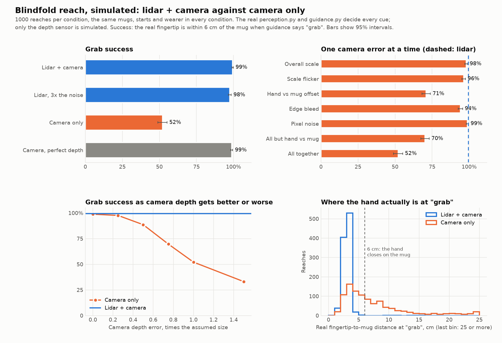

# Benchmark: lidar + camera against camera only

**Result (simulated, 1000 reaches each):** with lidar + camera, the blindfolded hand closes on the mug
**99.4%** of the time (±0.5). With camera only, where depth is estimated from the colour image, it does
so **52.1%** of the time (±3.1). These numbers come from a simulation, not from trials on the real
phone, and the camera's error sizes are assumptions (see "Limits" below).



Reproduce (about a minute on the GX10; the same seeds give the same numbers):

```bash
source .venv/bin/activate
python tools/sim_lidar_vs_camera.py --trials 1000 --out docs/benchmarks/lidar_vs_camera.json --plot docs/benchmarks/lidar_vs_camera.png
```

Run on 2026-10-10 against `main` at `73774e8`. Every number on this page is in `lidar_vs_camera.json`.

## What is simulated and what is real

- **Real code:** `perception.Perception` turns depth into the mug and fingertip positions (box depth,
  fingertip depth, memory while the hand covers the mug, the size fallback, smoothing).
  `guidance.Guidance` decides when to say "grab" (within 5 cm for 0.3 s). The Cosmos fallback is off.
- **Simulated:** the scene, the depth sensor, and the wearer.
  - A mug stands on a table 40–65 cm in front of a chest camera tilted down 30°.
  - The right hand starts near the chest and reaches from the shoulder.
  - The detector and hand tracker report the true box and fingertip with about 2 px of noise.
    That noise is the same in every condition, so any difference comes from the depth.
  - The wearer follows the direction of the cue, with a 0.2 s reaction delay and some
    shakiness, until guidance says "grab" or 20 s pass.
- **Success:** the real fingertip is within 6 cm of the mug's front face when guidance says "grab".
- **Same trials everywhere:** every condition uses the same 1000 mugs, starting positions and
  wearer movements.

### Depth models

| | How it is modelled |
|---|---|
| Lidar | The iPhone's 256 × 192 grid (pixels at an edge blend near and far), noise of 0.3 cm + 0.7% of the distance, no reading closer than 20 cm |
| Camera only | The true depth, distorted by the five errors in the next table |

| Camera error | What it is | Assumed size |
|---|---|---|
| Overall scale | One wrong scale for the whole session: from one image, the model cannot tell how big the room is | σ 15% |
| Scale flicker | That scale wobbles from frame to frame | σ 3% |
| Hand vs mug offset | After the overall scale, the hand and the mug are each off by their own amount | σ 5% mug, 8% hand, plus 3% wobble on the hand |
| Edge bleed | Depth is smooth across edges, so a hand next to the mug takes on some of the mug's depth | 4 px blur |
| Pixel noise | Per-pixel noise | 1% |

## Results

| Condition | Success | Wrong grab | Median miss at grab | 90% of misses within |
|---|---|---|---|---|
| Lidar + camera | 99.4% | 0.6% | 3.1 cm | 3.7 cm |
| Lidar, 3× the noise | 97.5% | 2.5% | 3.1 cm | 3.8 cm |
| Camera only | 52.1% | 47.5% | 5.8 cm | 14.9 cm |
| Camera, perfect depth | 98.8% | 1.2% | 3.1 cm | 3.7 cm |

One camera error at a time:

| Only this error | Success |
|---|---|
| Overall scale | 98.0% |
| Scale flicker | 96.3% |
| **Hand vs mug offset** | **71.0%** |
| Edge bleed | 94.1% |
| Pixel noise | 98.8% |
| All except hand vs mug | 70.2% |
| All together | 52.1% |

All camera errors scaled together:

| Error size vs assumed | 0× | 0.25× | 0.5× | 0.75× | 1× | 1.5× |
|---|---|---|---|---|---|---|
| Camera-only success | 98.8% | 97.6% | 88.6% | 69.7% | 52.1% | 33.1% |

## Why lidar helps

1. **A wrong overall scale barely matters.** If everything looks 15% farther away, the hand-to-mug gap
   also looks 15% too big. That error shrinks as the hand closes in and almost vanishes at the grab:
   98% success with this error alone.
2. **The hand and the mug being off by different amounts is what hurts.** A depth model guesses depth
   from appearance, separately for each thing in view. A hand close to the lens gives it little to go on.
   That error does not shrink as the hand approaches, so "grab" fires while the hand is still short of
   the mug or has gone past it. Lidar measures how long light takes to come back at every point, so its
   error is about 1 cm whatever is there, and the hand and the mug are measured the same way.
3. **The errors add up against a small margin.** "Grab" fires within 5 cm, and the hand closes on the
   mug within about 6 cm, which leaves 1–2 cm of slack. Each error alone mostly fits in it; together
   they do not. Even without the hand vs mug error, the rest combined give 70%.
4. **The result does not depend on the exact error sizes.** Camera only falls below 90% once its errors
   are half the assumed size, and only matches lidar at a quarter of it. Lidar with three times its
   noise still succeeds 97.5% of the time.

## Limits

- **Camera errors are assumed, not measured.** They are typical of single-image depth models, but have
  not been checked on our phone. To measure them, run a depth model (e.g. Depth Anything V2, as in the
  `nolidar` branch) next to the lidar on the same frames, and pass the sizes with `--camera-errors`.
- **Lidar's known failures are not modelled:** clear, shiny and black surfaces (a clear water bottle,
  for example) give bad lidar depth. The one modelled gap, no reading under 20 cm, is covered by
  perception's size fallback.
- **Simple wearer:** the simulated wearer follows the cue direction. Real people use beep rate, pitch
  and pan differently, and hesitate.
- **Nothing here compares against other products** such as smart glasses.
